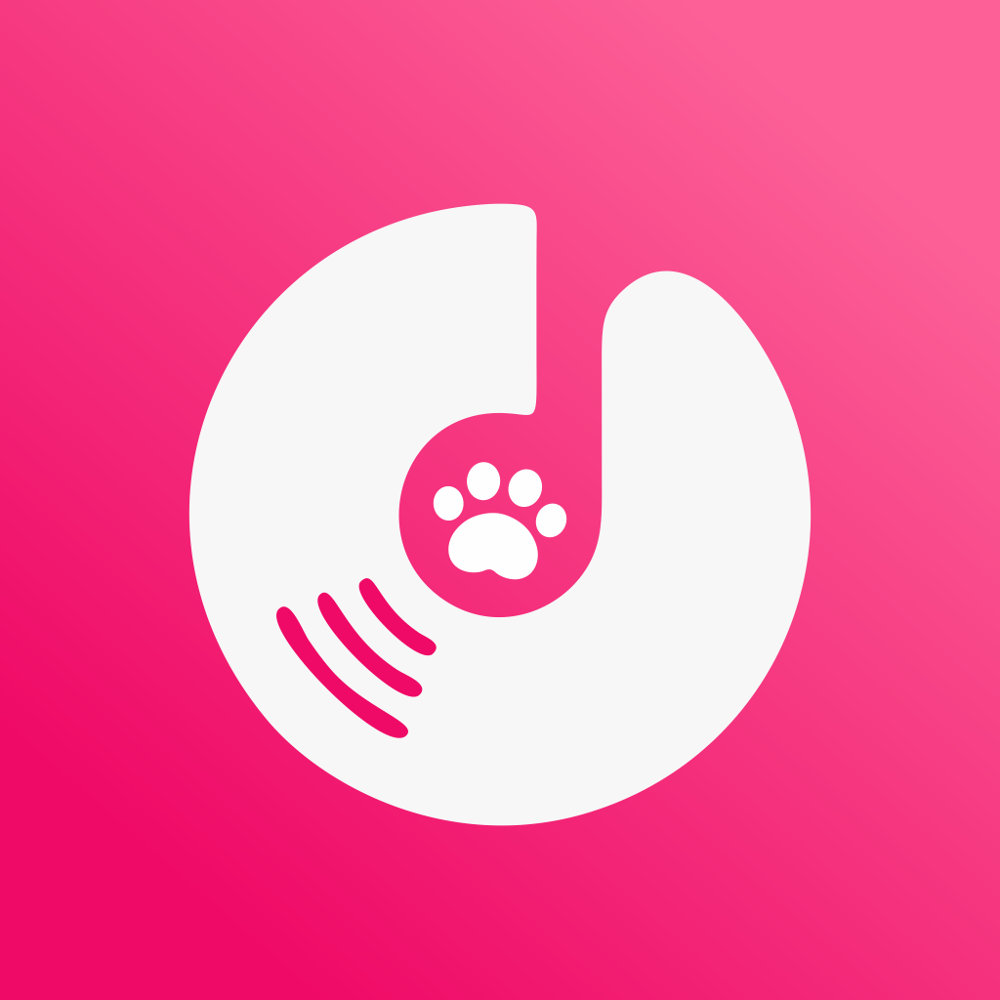

<p align="center">
  
</p>

<h1 align="center">MiguGo</h1>

<p align="center">
  <strong>一个使用 Flutter 编写的咪咕音乐客户端</strong>
  <br />
  Windows · Android · 原生登录 · 在线流式播放
</p>

<p align="center">
  
  
  
  
</p>

<p align="center">
  
  
</p>

---

## 📖 简介

MiguGo 是一个使用 Flutter 编写的个人练习项目：在 Windows 与 Android 上浏览咪咕音乐公开曲库、在线流式播放歌曲并查看同步歌词。支持每日推荐、搜索、公开歌单、导入歌单与原生登录，VIP 曲目按账号权益播放。

界面全部由 Flutter 自绘；只有按需打开的咪咕官方登录窗口，以及播放 VIP 曲目时的官方网页播放器，会临时加载咪咕自己的页面。

> ⚠️ 本软件【MiguGo】仅为个人学习练习项目，非咪咕官方软件，仅供本人自用，不对外分发；音乐版权归属咪咕及对应版权方。

- 接口协议、登录状态与实现细节：[docs/接口与实现.md](docs/接口与实现.md)
- 完整隐私政策：[docs/隐私政策.md](docs/隐私政策.md)

---

## ✨ 核心功能

### 🎧 首页与搜索

- **每日推荐** — 咪咕官方每日推荐与首页栏目配置，「今日推荐」歌曲列表 + 「精选歌单」横向卡片，可打开推荐歌单。
- **刷新与换一批** — 下拉刷新或换一批；刷新失败时保留上一次成功的内容。
- **搜索** — 单曲与公开歌单双 Tab，展示歌名、歌手、专辑，支持失败重试。
- **分页** — 按咪咕接口 20 条 / 页逐页追加，结果底部提供「加载更多」。
- **搜索历史** — 最近 10 条，可关闭、可清空。
- **播放交互** — 移动端单击起播并进入播放页；桌面端双击起播，单击只给出悬停反馈。

### 📚 歌单

- **公开歌单** — 封面、创建者、标签、简介与歌曲列表，可整单播放或从任意一首开始。
- **我的音乐** — 登录后只读展示「我喜欢的音乐」、自建与收藏歌单，分页加载、整单播放；退出登录即清空。
- **外部歌单导入** — 粘贴网易云音乐、QQ音乐或酷狗音乐分享链接（短链接自动跟随跳转），读取公开曲目并逐首匹配咪咕曲库。
- **导入限制** — 单次最多扫描 500 首、并发 4、最多保存 20 个歌单；遇到咪咕限流会立即停下并提示。
- **匹配结果** — 保留原歌单顺序，未匹配的曲目列在页面底部，不会静默丢弃。

### ▶️ 播放与歌词

- **在线播放** — 免费曲目与已登录账号的 VIP 曲目都走原生取链，`just_audio` 在线流式播放，不下载、不落盘。
- **音质** — 标准 / 高品质 / 无损三档，按账号权益逐级回退；切换后从下一首生效。
- **播放页** — 封面、歌曲信息、逐行同步歌词、进度拖动与音量调节。
- **播放控制** — 上一首 / 下一首、单曲循环 / 列表循环 / 随机播放、倍速、睡眠定时。
- **官方播放器兜底** — 原生取链被咪咕拒绝时，可在同一面板切到咪咕官方网页播放器。
- **桌面歌词** — Windows 独立原生歌词浮层，逐字颜色推进，可拖动与控制。

### 👤 登录与账号

- **原生登录** — 短信验证码与账号密码两种方式，整屏不出现网页。
- **图形验证码** — 咪咕风控时表单内显示原图，由本人输入，不识别、不代答。
- **官方页面兜底** — 风控拦下时可改用按需打开的官方通行证登录窗口；表单下方也随时可以主动切换。
- **个人中心** — 头像、昵称、打码手机号、VIP 标识、凭据项数、登录时间与最近校验时间；弹窗底部可展开隐私政策全文。
- **退出登录 / 切换账号** — 清凭据、票据与账号快照，停止播放并清空队列。
- **权益跟随官方** — 是否可播放完全由咪咕按账号权益判定，应用只携带用户自己的凭据发起请求。

### 🎨 外观与设置

- **主题** — 默认跟随系统明暗、强调色玫粉；可切换浅色 / 深色 / 跟随系统，以及玫粉 / 晴蓝 / 青绿 / 琥珀 / 紫罗兰五种强调色。
- **播放设置** — 默认播放模式、播放音质、音量记忆、歌词自动滚动、睡眠定时。
- **其他** — 环境光晕、搜索历史、快捷键开关与恢复默认；所有改动即时生效并保存在本机。
- **关于页** — 用途与版权声明、更新开关、合规边界与实现说明。

### 🖥️ 平台集成

- **Windows 播放** — SMTC 系统媒体卡片，屏幕媒体键交由系统媒体会话处理。
- **Windows 快捷键** — `Ctrl + Alt + 空格` 播放 / 暂停，`Ctrl + Alt + ←/→` 上一首 / 下一首；可选裸空格全局快捷键默认关闭。
- **Windows 界面** — 原生标题栏跟随主题切换深浅色；「设置 → 桌面歌词」可开独立歌词浮层。
- **Android 播放** — 通知栏与锁屏控制、后台播放、音频焦点；来电或其他应用占用音频时自动暂停。
- **交互差异** — 桌面歌曲行双击起播、单击只给悬停反馈；触屏单击即播并进入播放页。

---

## 🧱 技术栈

| 类别 | 技术 |
| --- | --- |
| **框架** | Flutter（Dart SDK ^3.13.5） |
| **状态管理** | `provider` — ChangeNotifier |
| **音频播放** | `just_audio` / `just_audio_windows` |
| **音频焦点与后台** | `audio_session`、`flutter_media_session` |
| **网络** | `dio` |
| **安全存储** | `flutter_secure_storage`（Android Keystore / Windows DPAPI） |
| **偏好与文件** | `shared_preferences`、`path_provider` |
| **WebView** | `flutter_inappwebview`（官方登录窗口、VIP 官方播放器） |
| **桌面窗口与快捷键** | `window_manager`、`hotkey_manager` |
| **图标与矢量** | `flutter_svg` |
| **代码规范** | `flutter_lints` |

---

## 🏗️ 架构

```text
pages / widgets          界面与自定义组件
        ↓
providers                播放、首页、搜索、歌单、导入、账号、设置
        ↓
services                 api / auth / audio / external / platform / web
        ↓
core / models            常量、主题、工具、数据模型
```

- **单向依赖** — 界面只读 Provider，网络与平台能力收在 `services/`。
- **手动 DI** — 构造函数注入，没有引入第三方依赖注入框架。
- **登录隔离** — 登录用的 Dio 与全局网络层分开，不携带本机旧凭据与统计 Cookie。
- **凭据落点** — 登录凭据写入系统安全存储，Cookie 只发给咪咕域名。

---

## 🚀 快速开始

需要本机已安装 Flutter SDK，Dart 版本满足 `pubspec.yaml` 中的 `^3.13.5` 约束。

```bash
# 克隆仓库
git clone https://github.com/ChenL-eon/MiguGo.git
cd MiguGo

# Windows（Git Bash）
flutter pub get
flutter run -d windows
flutter build windows --release

# Android
flutter devices
flutter run -d <device-id>
flutter build apk --release
```

### 环境要求

- Windows 构建需要 Visual Studio 2022 的「使用 C++ 的桌面开发」工作负载、C++ ATL 组件（`flutter_secure_storage` 需要）以及 Windows 10/11 SDK。
- Windows 的官方登录窗口与内嵌播放器都使用 `flutter_inappwebview`：需要 WebView2 Runtime，构建时还需要 NuGet CLI（把 `nuget.exe` 放进 `PATH`）。
- 两处 WebView 使用相互隔离的环境：`%LOCALAPPDATA%\migu_lele\webview2`（登录窗口，进出时清理 Cookie）与 `%LOCALAPPDATA%\migu_lele\webview2_player`（内嵌播放器，保留咪咕写入的会话）。
- 登录凭证与设置保存在 `%APPDATA%\cn.migulele\MiguGo`；从旧版本（Migu Lele）升级时会自动复制旧数据，已有文件不会被覆盖。
- Android 构建需要 Android SDK（API 24 及以上设备），JDK 17。
- 首次在 Windows 上运行插件相关构建时，可能需要开启 Windows 开发者模式以允许符号链接。

---

## 📁 项目结构

```text
lib/
├── app.dart                     # 应用入口、主题与全局快捷键包装
├── main.dart                    # 初始化、依赖注入与桌面窗口
├── core/
│   ├── constants/               # 应用常量、接口地址与合规文案
│   ├── navigation/              # 页面转场与主框架导航状态
│   ├── theme/                   # 浅色 / 深色色板、主题与排版
│   └── utils/                   # 歌词解析、输入解析、格式化
├── models/                      # 歌曲、歌单、账号歌单、首页推送、导入歌单、歌词、播放模式、音质档位
├── providers/                   # 播放、首页推送、搜索、歌单、歌单导入、账号、设置状态
├── services/
│   ├── api/                     # dio 客户端、Cookie 仓库、咪咕接口
│   ├── auth/                    # 原生通行证登录（RSA、登录接口）、网页登录 Cookie 清洗、登录完成判定与登录会话同步
│   ├── audio/                   # 系统媒体会话桥接
│   ├── external/                # 外部歌单抓取与曲目匹配（独立客户端，不带 Cookie）
│   ├── platform/                # Windows 全局快捷键、标题栏主题与旧版数据迁移
│   └── web/                     # WebView 环境与内嵌播放器地址
├── pages/                       # 首页推送、搜索、歌单导入、咪咕歌单、导入歌单、播放、设置、官方登录窗口、关于
└── widgets/                     # 自定义卡片、列表项、迷你播放器、账号弹窗与内嵌的原生登录面板、登录提示组件
test/                            # 歌词、模型、首页推送、歌单导入、Cookie 网页登录、主题色映射、设置持久化与合规文案测试
assets/
├── svg/                         # 界面矢量：透明底白色圆环，无底板、无圆角；粉色底板与圆角由 BrandBadge 绘制
└── icon_png/
    ├── master/                  # 1024 PNG 原稿母图
    ├── android/                 # 自适应图标：透明圆环前景 + 纯渐变背景；另有 legacy 各密度与 Play 512
    └── windows_ico_source/      # Windows 专用：母图已烘焙粉色圆角方形底板，用于打包 app_icon.ico
tool/
└── make_icons.ps1               # 从母图生成 Windows / Android 图标资源
docs/                            # 接口与实现、隐私政策全文
```

图标由 `tool/make_icons.ps1` 从 `assets/icon_png/master/MiguGo_1024.png` 生成并拷贝到各平台资源目录。界面位图不参与生成：圆角由 `BrandBadge` 的 `ClipRRect` 负责。Android 前景保持透明、不烘焙圆角，遮罩交给系统；Windows 没有系统圆角，圆角与粉色底板直接做进 PNG 母图，ICO 含 16–256 共 7 帧。

---

## ✅ 测试与检查

```bash
flutter analyze
flutter test --concurrency=1
```

当前共 473 个测试，覆盖登录协议与 RSA、会话续期与失效判定、VIP 取链与音质回退、歌单导入匹配、设置持久化、桌面歌词、Android 组件与合规文案等。

---

## 🛡️ 合规边界

项目在实现上固定遵循以下边界，不提供任何绕过手段：

- **只播放有权益的内容** — 账号权限完全跟随咪咕官方；只有登录咪咕账号、且该账号拥有对应曲目权益时，才可能拿到播放地址。
- **不下载、不解密** — 不实现歌曲下载、音频文件解密或本地持久保存音频文件，仅在线流式播放。
- **不内置密钥** — 原生登录只调用咪咕通行证与音乐站的会话接口；代码里不含任何账号密钥，也不生成官方风控签名。
- **验证码由人输入** — 只显示咪咕下发的原图，由登录者本人照着输入，应用不做识别、不自动作答。
- **WebView 仅两处** — 按需打开的官方通行证登录窗口，以及播放页为 VIP 曲目内嵌的官方网页播放器；不读取播放器页面里的音频地址。
- **不抓取、不登录第三方** — 只对接咪咕网页公开接口；第三方歌单仅在用户主动导入时读取公开曲目名与歌手。

完整实现约定见 [docs/接口与实现.md](docs/接口与实现.md#合规实现约定)。

---

## 🔒 隐私政策

完整正文在应用登录弹窗内展示，内容常量位于 `lib/core/constants/app_constants.dart`，同一份内容同步在 [docs/隐私政策.md](docs/隐私政策.md)。

- **没有自建服务器** — 没有统计、广告、崩溃上报或自动更新组件。
- **凭据只在本机** — 登录凭据写入系统安全存储（Android Keystore / Windows DPAPI），仅发送给咪咕域名。
- **敏感信息不落盘** — 手机号、验证码与密码加密后直接提交给咪咕，本机不落盘、不写日志。
- **最少权限** — 设备标识只发给咪咕；Android 清单只声明 `INTERNET`。

---

## ⚠️ 已知限制

- 咪咕公开接口并非稳定 API，可能出现字段变化、限流或地域限制；播放链接带时效。
- 原生登录走的是咪咕网页端自用协议，官方随时可能改参数或加风控；滑块等本表单无法呈现的形式只能改用官方页面登录，应用不会自动重试。
- 官方页面的「本机号码一键登录」依赖基站与 IP 判定，桌面端不可用，因此原生登录只提供短信验证码与账号密码两种。
- VIP 曲目只能按咪咕账号权益播放：账号无对应权益时服务端不会下发地址，应用不做本地提权。
- 外部歌单依赖各平台公开接口或公开页面：酷狗网页版只公开前 30 首；按标题与歌手匹配，重名、翻唱或信息不全时可能漏配或配错。
- 单次导入最多扫描 500 首、最多保存 20 个歌单；匹配并发 4，遇到咪咕限流会整单停下并提示稍后再试。
- 应用没有做单实例限制：请勿同时运行多个窗口或进程，多进程同时写本机凭据与偏好没有经过验证。
- Android 发布包当前使用 debug 签名，仅适合个人本地安装；如需长期使用请自行配置 release 签名。
- Windows 全局快捷键若被其他程序占用会注册失败，应用内空格与 SMTC 媒体键仍可使用。
- Windows 曾出现引擎无障碍桥随机闪退（`0xc0000005`，flutter/flutter#175041），现在由 `windows/runner/flutter_window.cpp` 拦下 `WM_GETOBJECT` 规避；代价是屏幕阅读器无法读取本应用窗口，等引擎修复后删掉拦截即可恢复。开发环境已完成 Windows Release 构建与连续 10 次启动验证，Android release APK 已构建并安装到真机启动（2026-10-22）。

---

## 📄 使用声明

本项目仅供个人学习与交流使用，非咪咕官方软件，请勿用于商业用途；音乐版权归属咪咕及对应版权方。

---

<p align="center">
  <sub>Made with Flutter · MiguGo</sub>
</p>
